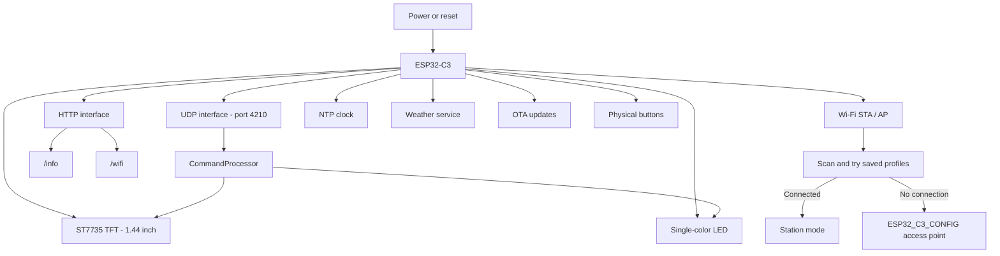
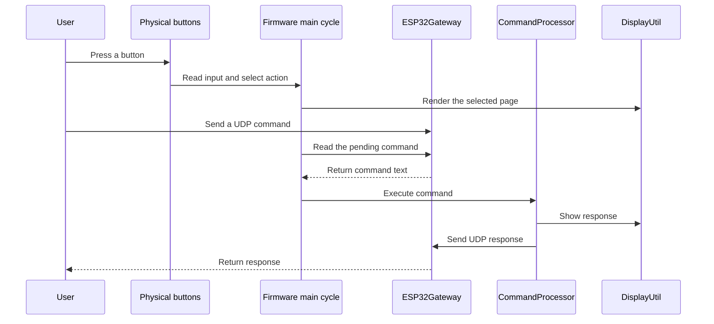

# ESP32-C3 Gateway


Gateway para **ESP32-C3** com display TFT 1.44", portal Wi-Fi, console UDP, NTP, clima, OTA e feedback visual por LED monocromático.

> Ideal para automação embarcada, dashboards locais, controle remoto de rede e monitoramento rápido do dispositivo.

## Visão geral

Este firmware foi feito para uma placa **ESP32-C3 com TFT ST7735 de 128 × 128 e LED de status monocromático**. Ele combina monitoramento local com configuração via navegador e comandos UDP leves.

### Funcionalidades

| Recurso | Implementação |
|---|---|
| Wi-Fi | Até cinco perfis persistentes de SSID/senha em lista circular |
| Conexão inicial | Varre redes salvas, tenta correspondências visíveis e cai para AP se necessário |
| Interface web | Informações do dispositivo em `/info` e gerenciamento Wi-Fi em `/wifi` |
| Interface local | Páginas de relógio, status, rede, sistema e redes salvas |
| Monitor de sinal | Barras adaptativas de RSSI e histórico visual do sinal |
| Tempo | NTP, fuso UTC configurável, DST e ajuste manual |
| Clima | Condições atuais via Open-Meteo para Porto Alegre |
| Controle remoto | Comandos UDP na porta 4210 |
| Atualização | ArduinoOTA via Wi-Fi |
| Economia de energia | Deep sleep pelo comando `desliga` |

A implementação **não inclui Ethernet, SD, PSRAM nem LED RGB**. O nome histórico da classe `RGBLed` foi mantido, mas ela controla o LED monocromático da placa.

## Arquitetura



## Fluxo de interação



## Quick start

1. Coloque `ESP32C3.ino` e todos os arquivos `.h` e `.cpp` na mesma pasta chamada `ESP32C3`.
2. Instale **ESP32 by Espressif Systems 3.x** no Arduino IDE.
3. Instale **GFX Library for Arduino (Arduino_GFX)**.
4. Selecione **ESP32C3 Dev Module** e a porta serial correta. Ative **USB CDC On Boot** se for usar o monitor serial via USB nativo.
5. Selecione o tamanho de flash compatível com sua placa e um esquema de partições com OTA. O esquema atual usa um chip W25Q128 de 16 MB; confirme a revisão física da placa.
6. Compile e faça upload via USB. Use **115200 baud** no monitor serial.

As bibliotecas de Wi-Fi, HTTP, Preferences, NTP e OTA já vêm no pacote ESP32. `SdFat` e `Adafruit_NeoPixel` não são necessários.

### Primeira conexão

Se nenhuma rede salva conectar, entre em **ESP32_C3_CONFIG** e abra **http://192.168.4.1**. Salve as credenciais da sua rede; o dispositivo reinicia e tenta conectar novamente.

Depois de conectado, use o IP mostrado no display:

- `http://DEVICE_IP/info` — informações do dispositivo e da rede.
- `http://DEVICE_IP/wifi` — perfis salvos e cadastro de redes.

## Perfis Wi-Fi

O dispositivo armazena até cinco SSIDs e senhas na flash persistente. Os novos perfis seguem a ordem **1 → 2 → 3 → 4 → 5 → 1**. Quando a lista está cheia, o próximo cadastro substitui o perfil mais antigo.

Na inicialização, o firmware escaneia as redes próximas e tenta os perfis salvos visíveis em ordem circular, com cerca de dez segundos por tentativa. Se nenhuma conectar, ele inicia o ponto de acesso de configuração.

Redes ocultas não são descobertas pela varredura atual. A troca entre SSIDs salvos acontece na inicialização, não durante a execução.

## Display e controles

A interface é rotacionada 90 graus no sentido anti-horário. Páginas auxiliares retornam ao relógio após 30 segundos; respostas UDP aparecem no console por dez segundos. O protetor de tela inicia após 15 minutos de inatividade.

| Controle | Ação |
|---|---|
| Key1 · GPIO8 | Avança para a próxima página quando pressionado |
| BOOT · GPIO9 | Avança para a próxima página quando pressionado |
| Key2 · GPIO10 · toque curto | Avança para a próxima página ao soltar |
| Key2 · 3 segundos, depois soltar | Reinicia |
| Key2 · 10 segundos, depois soltar | Apaga os perfis Wi-Fi salvos e reinicia |
| RESET | Reinicia, incluindo recuperação do deep sleep |

Não mantenha o botão BOOT pressionado ao ligar ou resetar: isso ativa o modo de download do firmware.

### Visualização do sinal

As barras de cabeçalho e o traço verde usam leituras reais de RSSI, amostradas aproximadamente uma vez por segundo. O histórico contém 50 amostras. A escala adaptativa tem amplitude mínima de 8 dBm para evidenciar variações pequenas.

## Referência de comandos UDP

Envie texto de comando para o IP do dispositivo na **porta UDP 4210**. As respostas retornam para o endereço e porta de origem. Os nomes dos comandos foram mantidos por compatibilidade com clientes existentes.

| Categoria | Comandos |
|---|---|
| Geral | `help`, `info`, `status`, `uptime`, `reason`, `version`, `build`, `alive` |
| Hardware | `temp`, `cpu`, `ram`, `flash`, `chip_info`, `health` |
| Rede | `net_info`, `mac`, `rssi`, `ip`, `ssid`, `channel`, `wifi_status` |
| Reset de rede | `reset_wifi` |
| Tempo | `time`, `date`, `ntp_status`, `set_fuso:X`, `set_time:YYYY-MM-DD HH:MM:SS`, `dst_on`, `dst_off` |
| LED | `led_on`, `led_off`, `led_breath`, `led_pisca:P:I`, `led_blink:I` |
| Clima | `clima`, `clima_age`, `clima_sync` |
| Energia | `reboot`, `desliga` |

- `set_fuso:X`: fuso UTC de −12 a +14; padrão −3.
- `set_time:2026-10-07 14:30:00`: define a hora local manualmente. O NTP pode substituir depois de uma nova sincronização.
- `led_pisca:P:I`: 1–100 pulsos, com intervalo de 1–5000 ms.
- `led_blink:I`: piscada contínua, com intervalo de 50–60000 ms.
- `desliga`: entra em deep sleep até RESET ou ciclo de energia.

### Exemplo de cliente

```python
import socket

with socket.socket(socket.AF_INET, socket.SOCK_DGRAM) as client:
    client.settimeout(5)
    client.sendto(b"status", ("192.168.1.100", 4210))
    try:
        while True:
            data, _ = client.recvfrom(4096)
            print(data.decode("utf-8", errors="replace"))
    except socket.timeout:
        pass
```

Troque o IP de exemplo pelo endereço do dispositivo. Comandos como atualização do clima podem demorar mais do que o timeout do cliente.

## Clima e OTA

As coordenadas do clima são configuradas em `ClimaManager.h`. Uma sincronização bem-sucedida define intervalo de 15 minutos; enquanto não houver dados sincronizados, o firmware tenta novamente a cada um minuto. `clima_age` mostra há quanto tempo os dados foram atualizados.

O OTA usa o hostname **ESP32-C3-Gateway** após a conexão Wi-Fi. Faça o primeiro upload via USB, use partições compatíveis com OTA e garanta que o computador consiga alcançar o dispositivo pela rede.

## Deep sleep e bateria

`desliga` envia uma resposta, para o Wi-Fi e o LED, desliga o controlador do LCD e entra em deep sleep sem timer de wake-up. Os perfis salvos permanecem gravados. Acorde o dispositivo usando **RESET** ou um ciclo de energia.

Key1, Key2 e BOOT não acordam esta implementação a partir do deep sleep. O **backlight permanece alimentado** porque está ligado diretamente em 3.3 V. O firmware reduz o consumo do processador, mas não desliga a iluminação da tela.

## Hardware

| Sinal | GPIO |
|---|---:|
| LCD CS | 2 |
| LCD DC | 0 |
| LCD reset | 5 |
| LCD MOSI | 4 |
| LCD clock | 3 |
| LED monocromático | 11 |
| Key1 | 8 |
| BOOT | 9 |
| Key2 | 10 |
| USB D− / D+ | 18 / 19 |

O display usa SPI por software. `BoardConfig.h` define pinos, dimensões do painel, offsets e rotação. O painel atual usa offsets 2/3; revisões diferentes podem exigir ajuste.

## Estrutura do projeto

| Arquivo | Responsabilidade |
|---|---|
| `ESP32C3.ino` | Inicialização, botões, navegação de páginas, loop principal |
| `BoardConfig.h` | Configuração da placa e do display |
| `ESP32Gateway.*` | Perfis Wi-Fi, rotas HTTP, comunicação UDP |
| `CommandProcessor.*` | Despacho de comandos e diagnósticos |
| `DisplayUtil.*` | Páginas e visualização de RSSI |
| `NTPUtil.*` | Relógio, UTC offset e ajuste manual |
| `ClimaManager.h` | Requisições de clima |
| `OTAManager.h` | Tratamento de OTA |
| `RGBLed.*` | Controle do LED monocromático |

## Segurança e validação

O AP é aberto; a configuração HTTP, os comandos UDP e o OTA não têm autenticação. O cliente HTTPS do clima usa `setInsecure()` e não valida certificados. Use em rede confiável.

A conexão Wi-Fi e o funcionamento do firmware foram confirmados em uma revisão anterior. Mudanças posteriores receberam revisão estática; ainda é recomendado compilar e testar em hardware antes de distribuir.

Substitua o conjunto completo de fontes ao atualizar para evitar misturar headers e implementações incompatíveis.

## Contribuindo

Inclua a revisão da placa, a versão do pacote ESP32, as versões das bibliotecas, os passos para reproduzir e a saída completa de erro ao abrir uma issue. Remova senhas e informações privadas dos logs.

## Licença

Nenhuma licença foi definida ainda.

## Changelog

Veja [CHANGELOG.md](CHANGELOG.md) para o histórico completo e documentado de alterações.
